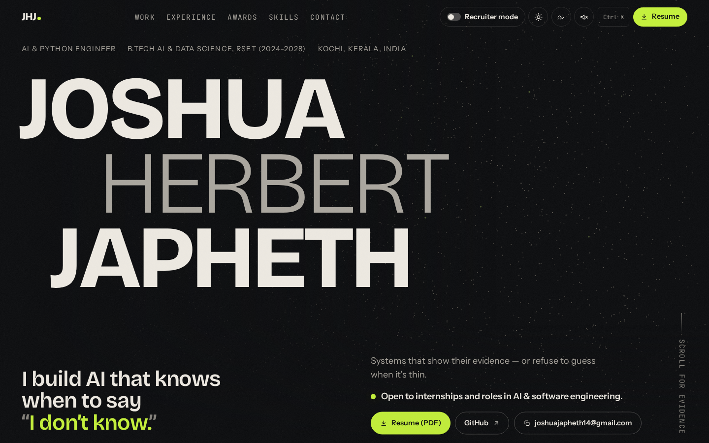

# Joshua Herbert Japheth — portfolio

**Live: https://stredevirad.github.io/portfolio/**



AI & Python engineer in Kochi, India. This site is built around one idea from my project Aegis:
**AI that knows when to say “I don’t know”** — systems that show their evidence or refuse to guess when it is thin.
The site follows the same rule: every number on it links to the repo and file it came from.

Designed and directed by Joshua; built with Claude Code.

## What's inside

- Prerendered home page, five case studies (`/work/<slug>/`) and a plain resume page (`/resume/`) — every route is real HTML, so deep links, link previews and no-JS visits work.
- WebGL hero (lazy three.js particle field that snaps from noise into an evidence graph) with a static SVG fallback for reduced motion, low-end devices and no-WebGL.
- First-visit preloader, pinned horizontal work reel with a Flip hand-off into each case study, self-drawing timeline, animated architecture diagrams, custom cursor, magnetic buttons, scroll-velocity type.
- Toggles that persist: theme (circular View Transitions reveal), motion, sound (Web Audio, synthesised — no samples), and **Recruiter mode** — a fast, single-column, printable view with a resume PDF generated at build time from the same content.
- Command palette (<kbd>Ctrl</kbd>/<kbd>⌘</kbd>+<kbd>K</kbd>) and a small terminal (<kbd>`</kbd>).

## Stack

Vite 8 · React 19 · TypeScript (strict) · GSAP 3.15 (ScrollTrigger, SplitText, Flip) · Lenis · three.js (lazy) ·
plain CSS on design tokens · Playwright (tests, PDF, OG image) · axe-core · Lighthouse · GitHub Pages via Actions.
Decisions and trade-offs are in [`docs/ARCHITECTURE.md`](docs/ARCHITECTURE.md) and [`docs/adr/`](docs/adr/).

## Local development

```bash
npm ci
npm run dev        # http://localhost:5173/portfolio/  (client-rendered dev server)
npm run build      # typecheck → build → prerender + sitemap + OG image + resume PDF
npm run preview    # serve dist/ like GitHub Pages → http://127.0.0.1:4173/portfolio/
npx playwright install --with-deps chromium   # once, for build artifacts and tests
npx playwright test
npm run lighthouse # mobile Lighthouse → docs/lighthouse/
```

Requires Node ≥ 20.

## Editing content

All facts and copy live in typed files under [`src/content/`](src/content/) — components never hard-code them:

| File | What |
|---|---|
| `site.ts` | name, links, hero lines, principles, navigation, meta |
| `projects.ts` | projects, case studies, architecture diagrams, results (as sourced `Claim`s) |
| `experience.ts` | timeline |
| `achievements.ts` | awards, certificates, marquee |
| `skills.ts` | skill groups (no bars, no percentages) |

Every number is a `Claim` with a source, a date and a status, and must trace to [`docs/PORTFOLIO_FACTS.md`](docs/PORTFOLIO_FACTS.md).
Anything not yet verified goes to [`docs/OPEN_QUESTIONS.md`](docs/OPEN_QUESTIONS.md), not onto the site.
Project screenshots: drop PNGs in `assets-src/projects/` and run `npm run images`.

## How deploys work

Pushing to `main` runs [`.github/workflows/deploy.yml`](.github/workflows/deploy.yml): install → Chromium → build →
JS budget check (≤ 200 KB gzip initial) → Playwright suite → upload the `dist/` artifact → deploy to GitHub Pages.
The Vite `base` is `/portfolio/`, matching the repository name.

## Credits

Fonts: Bricolage Grotesque, Instrument Sans, JetBrains Mono — SIL Open Font License 1.1 (licenses in `public/fonts/`).
Sounds: synthesised in the browser with the Web Audio API. Project images are from my own repositories; the Kerala flood
map contains modified Copernicus Sentinel-1 data (2018).

Code: MIT.
